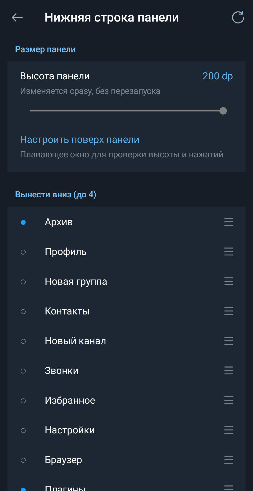
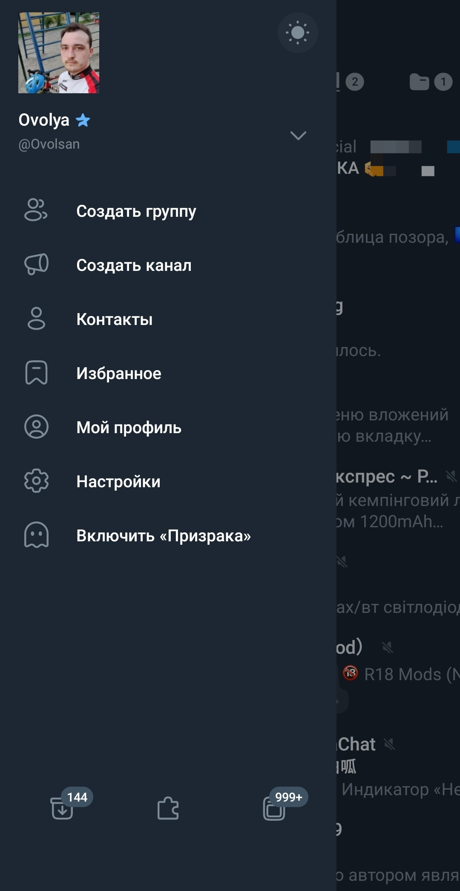
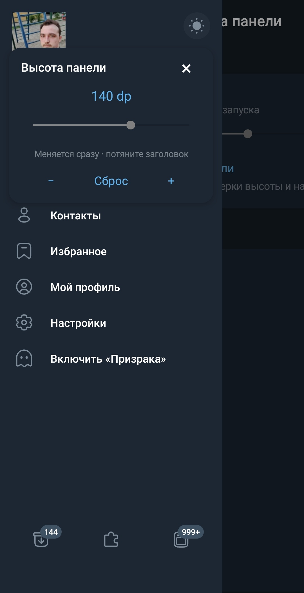

# Drawer dock — Нижняя строка панели

Плагин для **exteraless**, который переносит выбранные пункты бокового меню
в закреплённую панель кнопок внизу.

**Версия:** `20261018`.

**Авторы:** [@aura_plugins](https://t.me/aura_plugins),
[@bandaliyev](https://t.me/bandaliyev), [@Ovolsan](https://t.me/Ovolsan),
[@Ovolpost](https://t.me/Ovolpost).

[Скачать плагин](https://github.com/Ovolsan/Drawer-dock/releases/latest/download/drawer_dock.plugin)
· [Установка через Github plugin installer](https://raw.githubusercontent.com/Ovolsan/Drawer-dock/main/drawer_dock.plugin)
· [Релизы](https://github.com/Ovolsan/Drawer-dock/releases)

## Возможности

- До **четырёх кнопок** внизу боковой панели. Пункты, вынесенные вниз,
  убираются из основного списка меню.
- Выбор пунктов и изменение их порядка: нажмите на пункт в настройках,
  чтобы включить или выключить его; зажмите и перетащите для сортировки.
- Высота панели **40–200 dp**, исходная высота — **56 dp**.
- **Плавающее окно настройки:** двигайте ползунок и сразу проверяйте высоту
  и удобство нажатий. Окно перемещается за заголовок; есть кнопки «−», «+»,
  «Сброс» и закрытие крестиком.
- Нажатие на кнопку выполняет действие соответствующего пункта меню;
  долгое нажатие показывает его название.
- Счётчики непрочитанных для **«Архива»** и **«Ленты»**.
- Выбор кнопок, порядок и высота сохраняются после перезапуска.
- Цвета берутся из текущей темы клиента.

Для переноса доступны: «Архив», «Профиль», «Новая группа», «Контакты»,
«Новый канал», «Звонки», «Избранное», «Настройки», «Браузер», «Плагины»,
«Войти по QR», «Лента», «Режим призрака», «Недавние чаты».
Отображаются только пункты, которые сейчас доступны в боковом меню клиента:
например, пустой архив может отсутствовать.

## Скриншоты

Скриншоты настроек, нижней панели и плавающего окна в exteraless.
Снимки панели и плавающего окна опубликованы целиком. На изображениях
показаны разные значения высоты.

| Настройки | Нижняя панель | Плавающее окно |
|---|---|---|
|  |  |  |

## Установка

1. Скачайте [drawer_dock.plugin](https://github.com/Ovolsan/Drawer-dock/releases/latest/download/drawer_dock.plugin)
   и откройте файл в exteraless.
2. Подтвердите установку. В разрешениях плагина выберите уровень
   **«Доверенный»** и включите **«Переписывать код приложения» (hooks)**.
   Предоставьте **«Чтение сообщений»** для счётчиков, если клиент запрашивает
   это разрешение.
3. Активируйте плагин и откройте его настройки.
4. Выберите от одного до четырёх пунктов, которые хотите вынести вниз.
5. Откройте боковое меню: выбранные кнопки появятся внизу.

Если установлен и включён **Github plugin installer**, откройте
[RAW-ссылку на плагин](https://raw.githubusercontent.com/Ovolsan/Drawer-dock/main/drawer_dock.plugin)
**в чате exteraless**. Установщик предложит установку или обновление;
подтвердите действие в клиенте.

## Настройка высоты

Откройте **Плагины → Нижняя строка панели → настройки**.

- **«Высота панели»** — ползунок от 40 до 200 dp.
- **«Настроить поверх панели»** — открывает боковое меню и плавающее окно.
  Панель меняется прямо во время движения ползунка; значение сохраняется
  при отпускании. Кнопки меню остаются доступными для проверки нажатий.
- **«−» / «+»** — изменение на 1 dp; **«Сброс»** возвращает 56 dp.
- Перетащите окно за заголовок, если оно мешает. Закройте крестиком;
  при уходе из приложения окно также закрывается.

Высота относится к строке кнопок; системная навигационная область
учитывается отдельно. Размер самих значков остаётся прежним.

## Обновление и совместимость

Внутренний идентификатор **`drawer_dock`** сохранён: установка поверх
предыдущей версии обновляет тот же плагин с сохранением его настроек.

Исправлено исчезновение панели в exteraless: старое и новое имена Java-класса
меню могут обозначать один класс. Теперь обработчики подключаются к нему
только один раз.

Подробности: [CHANGELOG.md](CHANGELOG.md), [проверка на смартфоне](VALIDATION.md).
Контрольная сумма файла опубликована в [SHA256SUMS.txt](SHA256SUMS.txt).
